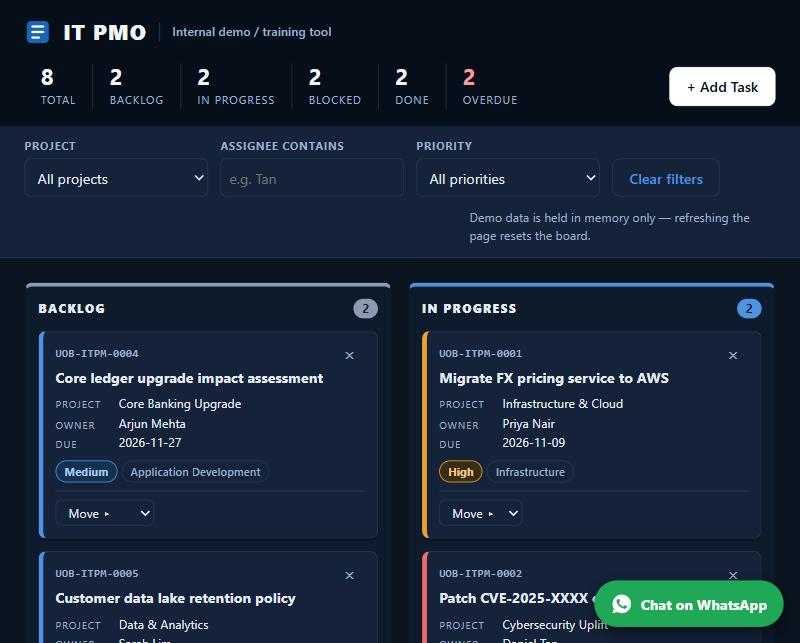

# IT PMO Kanban Board

A single-page Kanban board for an IT project management office (PMO), built as an internal demo and training tool for a fictitious bank. No frameworks, no build step.

**Live demo:** https://grakeshk-max.github.io/Kanban8/

## Features

- Four-column board: Backlog, In Progress, Blocked, Done
- Drag and drop cards between columns, or use the keyboard "Move" menu
- Add tasks (`UOB-ITPM-####` IDs) with inline validation and a toast confirmation
- Filter by project, assignee and priority; header summary shows totals and overdue count
- Inline Yes/No delete confirmation
- A "Gennie" chat widget linking to WhatsApp, and a meeting reminder dialog after 10 seconds on the page (both in `.claude/hooks/`)

## Run it

Open `index.html` in a browser. No server needed. Keep the `.claude/hooks/` folder next to it.

## Tech and constraints

- Vanilla HTML, CSS and JavaScript only; no CDN, web fonts or image files
- No persistence: refreshing the page resets the board to seed data
- Only network call is the FormSubmit endpoint for new-task notifications (`FORMSUBMIT_ENDPOINT` is a placeholder; set your own to enable it)
- Demo data only; the wordmark is a neutral "IT PMO" text mark
